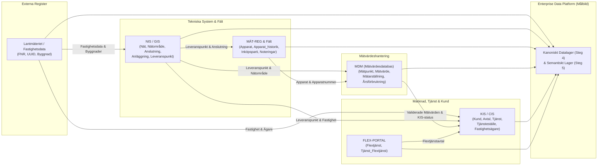

# Lösningsarkitektur: Systemlandskap & Integrationer (Steg 2)

Detta dokument beskriver det nuvarande systemlandskapet hos **Svea Stadsenergi & Nät AB** och hur data flödar mellan källsystemen till det gemensamma datalagret.

---

## 1. Översikt av Källsystem

| Systemkortnamn | Systemtyp | Ansvarsområde / Domäner som ägs i systemet |
| :--- | :--- | :--- |
| **KIS / CIS** (Kund- & Faktureringssystem) | Kärnsystem Marknad & Nätavtal | Äger **Kund**, **Avtal**, **Tjänst** (inkl. undertyperna för El, Fjärrvärme, Fjärrkyla, Vatten, Stadsnät), **Tjänstestatus_historik**, **Tjänsteställe**, **Fastighetsägare_historik**, **Person_Roll** samt **Adress_historik**. |
| **NIS / GIS** (Nätinformationssystem) | Tekniskt dokumentationssystem | Äger det fysiska nätet: **Nät**, **Nätområde**, **Nätområde_aktör**, **Anläggning**, **Anslutning** (inkl. undertyper för alla 5 nyttigheter) och **Leveranspunkt** (teknisk stamdata). |
| **MDM** (Meter Data Management) | Mätvärdesdatabas & Validering | Äger **Mätpunkt**, **Mätpunktsdetalj_historik**, **Mätvärde** (tidsserier), **Mätarställning** (validerade registerställningar inkl. valideringsflaggor och KIS-status), **Årsförbrukning**, **Periodschema** samt **Enhet**/**Enhetstyp**. |
| **MÄT-REG / Fält** (Apparat- & Arbetsordersystem) | Mätarverkstad & Fältservice | Äger **Apparat**, **Apparat_historik** (montering på leveranspunkt), **Apparatstatus**, **Apparat_inköpsparti**, **Apparat_tillverkare**, **Apparattyp**, **Apparattyp_nyttighet**, **Avläsningsbok** och **Leveranspunkt_noteringar**. |
| **FAST-LM** (Fastighetsregister / Lantmäteriet) | Fastighets- & Byggnadsdata | Äger **Fastighet**, **Fastighetsdata** (`FNR`, `UUID`, `Kommunkod`), **Byggnad**, **Byggnadsdetaljer**, **Byggnadstyp**, **Byggnadsanvändning**, **Byggnadsstatus** och **Värmekälla**. |
| **FLEX-PORTAL** | Styrning & Flexibilitet | Äger **Flextjänst** och kopplingen **Tjänst_Flextjänst** mot KIS-tjänster. |

---

## 2. Integrationskarta (Mermaid)

---

## 3. Identifierade Integrationsutmaningar (Viktigt för Steg 4 & 5)

1. **Delade begrepp mellan tekniska och kommersiella system:**
   - **Leveranspunkt** skapas i NIS/GIS men refereras av både `Apparat_historik` (i MÄT-REG) och `Tjänst` (i KIS).
   - **Säkring** och **Volt** finns både på `Anslutning_El` (i NIS) och på `Tjänst_El` (i KIS).
2. **Bruten nyckelkedja mellan Apparat och Mätpunkt:**
   - `Apparat_historik` i MÄT-REG har den äkta surrogatnyckeln `Apparat ID` mot `Leveranspunkt ID`.
   - `Mätpunktsdetalj_historik` i MDM har endast det tryckta serienumret `Apparatnummer` mot `Mätpunkt ID`, där flera apparater kan ha samma `Apparatnummer`.
3. **Nyttighetspolymorfism (Multi-utility):**
   - Både `Anslutning` och `Tjänst` förekommer i 5 nyttighetsvarianter (*El, Fjärrvärme, Fjärrkyla, Vatten, Stadsnät*) med helt olika tilläggsattribut.
4. **Faktatabeller inbäddade i domänerna:**
   - Flera historik- och händelsetabeller fungerar i praktiken som faktatabeller/bryggor med tidsintervall (`Startdatum`–`Slutdatum` eller `Datum tid`), t.ex. `Mätvärde`, `Mätarställning`, `Årsförbrukning`, `Apparat_historik`, `Mätpunktsdetalj_historik`, `Tjänstestatus_historik`, `Fastighetsägare_historik`, `Nätområde_aktör` och `Adress_historik`.
