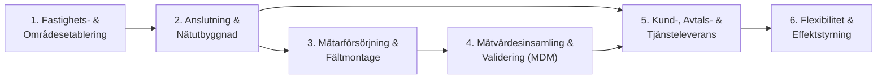

# Process- och Förmågearkitektur (Steg 3)

Detta dokument kartlägger vilka **affärsförmågor (Business Capabilities)** och **kärnprocesser** hos Svea Stadsenergi & Nät AB som skapar och konsumerar informationen, samt vilka system som realiserar dem.

---

## 1. Översikt av Kärnprocesser

---

## 2. Mappning: Process $\leftrightarrow$ Affärsförmåga $\leftrightarrow$ System $\leftrightarrow$ Informationsdomän

| Process | Affärsförmåga (Capability) | Stödjande System | Primära Verksamhetsbegrepp (Informationsentiteter) |
| :--- | :--- | :--- | :--- |
| **1. Fastighets- & Områdesetablering** | **Fastighets- & Byggnadsförvaltning** Förmåga att registrera fastigheter, byggnader, ytor, värmekällor och ägarhistorik. | `FAST-LM`, `KIS` | `Fastighet`, `Fastighetsdata`, `Fastighet_uppgifterva`, `Byggnad`, `Byggnadsdetaljer`, `Byggnadstyp`, `Byggnadsanvändning`, `Byggnadsstatus`, `Fastighet_Värmekälla`, `Värmekälla`, `Fastighetsägare_historik`, `Person_Roll`, `Adress_historik` |
| **2. Anslutning & Nätutbyggnad** | **Nät- & Anslutningshantering** Förmåga att projektera, ansluta och förvalta fysiska serviser och leveranspunkter per nyttighet och nätområde. | `NIS / GIS` | `Nät`, `Nätområde`, `Nätområde_aktör`, `Anläggning`, `Anslutning`, `Anslutningsstatus`, `Anslutning_Fastighet_historik`, `Anslutning_El` (`Säkring`, `Volt`), `Anslutning_Fjärrvärme`, `Anslutning_Fjärrkyla`, `Anslutning_Vatten`, `Anslutning_Stadsnät`, `Leveranspunkt`, `Leveranspunkt_noteringar`, `Avläsningsbok` |
| **3. Mätarförsörjning & Fältmontage** | **Apparat- & Livscykelhantering** Förmåga att köpa in, typklassificera, montera och revidera mätapparater ute på leveranspunkter. | `MÄT-REG / Fält` | `Apparat`, `Apparatstatus`, `Apparat_inköpsparti`, `Apparat_tillverkare`, `Apparattypbeteckning`, `Apparattyp`, `Apparattyp_nyttighet`, `Apparat_historik` |
| **4. Mätvärdesinsamling & Validering** | **Mätpunkts- & Mätvärdeshantering** Förmåga att konfigurera mätkanaler (mätpunkter), samla in tidsserier och mätarställningar, validera dem och beräkna årsförbrukning. | `MDM` | `Mätpunkt`, `Mätpunktsdetalj_historik`, `Enhet`, `Enhetstyp`, `Mätvärde`, `Mättyp`, `Mätstatus`, `Mätarställning` (`Fas`, `Avläsningsorsak`, `Avläsningstyp`, `Bruksdatavalidering`, `Rådatavalidering`, `KIS-status`, `Periodiseringsstatus`), `Årsförbrukning`, `Periodschema`, `Periodtyp` |
| **5. Kund-, Avtals- & Tjänsteleverans** | **Kommersiell Tjänste- & Avtalshantering** Förmåga att paketera och leverera nyttighetsspecifika tjänster på ett tjänsteställe enligt kundavtal. | `KIS / CIS` | `Tjänsteställe`, `Värmemetod`, `Tjänst`, `Tjänstestatus_historik`, `Tjänstestatus`, `Förbrukningsmönster`, `Utförande`, `Tjänst_El` (`Säkring`, `Volt`), `Tjänst_Fjärrvärme` (`Temperaturstation`), `Tjänst_Fjärrkyla` (`Nominellt_flöde_qn`), `Tjänst_Vatten`, `Tjänst_Stadsnät` (`Nätverkshastighet`, `TV_tjänst`), `Avtal`, `Kund` |
| **6. Flexibilitet & Effektstyrning** | **Flexibilitetshantering** Förmåga att knyta styrbara flextjänster till en kunds befintliga tjänsteleverans över tid. | `FLEX-PORTAL`, `KIS` | `Flextjänst`, `Tjänst_Flextjänst` |

---

## 3. Förmågornas krav på Informationsmodellen (Steg 4) och Semantiska Modellen (Steg 5)

1. **Tydlig gränsdragning mellan Fysisk Infrastruktur och Kommersiell Affär:**
   - Förmågorna 1–3 arbetar med fysiska objekt (`Fastighet`, `Byggnad`, `Anslutning`, `Leveranspunkt`, `Apparat`).
   - Förmåga 4 bryggar fysik och mätdata (`Mätpunkt`, `Mätvärde`, `Mätarställning`, `Årsförbrukning`).
   - Förmågorna 5–6 arbetar med kommersiella objekt (`Tjänsteställe`, `Tjänst`, `Flextjänst`, `Avtal`, `Kund`).
2. **Stöd för tidsvariation (Historik / Fakta):**
   - För att kunna svara på hur nätet, mätarbeståndet, ägarbilden och tjänsterna såg ut vid varje historisk tidpunkt krävs explicita historikentiteter (`Apparat_historik`, `Mätpunktsdetalj_historik`, `Tjänstestatus_historik`, `Fastighetsägare_historik`, `Anslutning_Fastighet_historik`, `Nätområde_aktör`, `Adress_historik`, `Tjänst_Flextjänst`).
